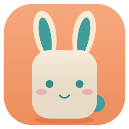
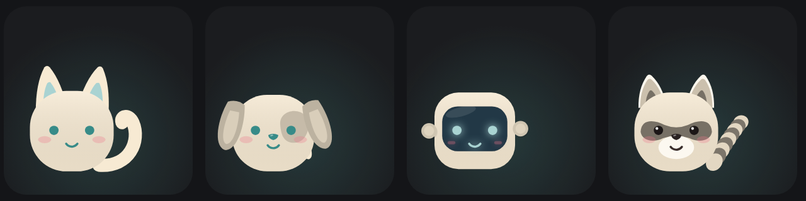
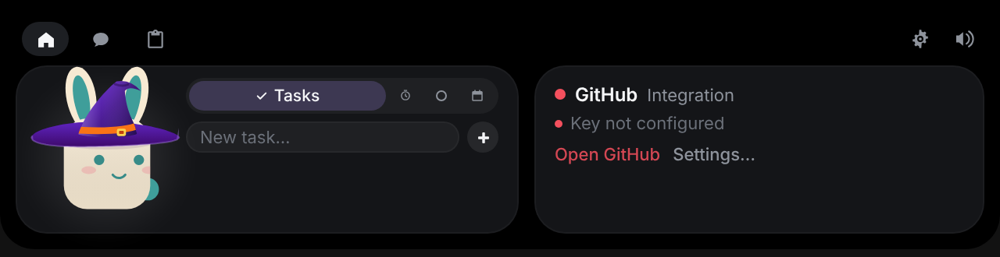
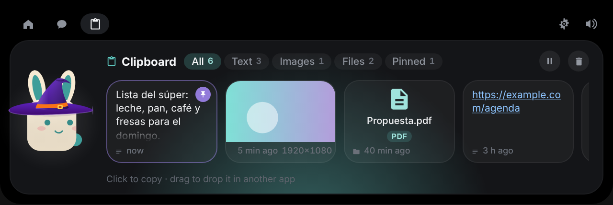
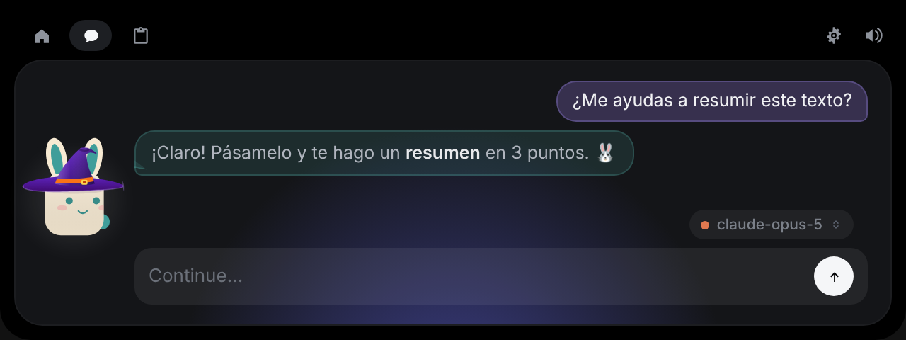

<div align="center">



# Tokkip

**Un compañerito que crece contigo cuando te cuidas.**

Tokkip vive en tu Pixel, en tu reloj, en tu coche y arriba de la pantalla de tu PC.
Te recuerda tus pendientes, respira contigo, cuida tu sueño, guarda lo que copias
y platica contigo, siempre con la misma carita.




</div>

---

## Conoce a Tokkip

Tokkip es un personaje dibujado en código, sin imágenes ni animaciones prehechas. Puede
ser **conejito, gatito, perrito, robotito o mapache**, con piel **lisa** o
**ensueño**, y tú eliges todos sus colores: cuerpo, acento, ojos y boca, y mejillas.

Parpadea, te sigue con la mirada, se pone feliz cuando cumples tus rachas, se marea
si lo picas mucho, tiene ojeras si dormiste mal y saluda con sus manitas (el
robotito con sus bolitas flotantes). Se viste según la temporada: gorro de bruja en
octubre, gorro navideño en diciembre.

## Dónde vive

### En tu teléfono (Pixel, Android 12+)

- **Inicio**: Tokkip, tu día de un vistazo, lo que suena y tus pendientes.
- **Tokkip crece contigo**: cada vez que te cuidas (rachas, diario, ánimo,
  respirar, dormir) le das cariño. Pasa por seis etapas, de *Recién llegado* a
  *Leyenda*, y después el ciclo sigue dando vueltas (★1, ★2…). Se calcula con tu
  propio historial, así que una copia restaurada trae su crecimiento.
- **Tokkip notó…**: una frase y una sugerencia según tu rutina. Lee cómo y cuándo
  escribes en tu diario, el tono de tus palabras y de qué hablas, y lo cruza con
  tu ánimo, tus rachas, tu sueño y tus respiraciones ("los días que cumples
  «Caminar» te sientes mejor"). Todo en el teléfono: sin IA ni internet.
- **Ánimo y diario**: cómo te sientes, con notas y fotos; exportable a PDF.
- **Dinero**: tus gastos e ingresos con un presupuesto semanal y uno de fin de
  semana dentro de él (tú decides los montos, si la semana empieza en lunes o
  domingo y si el fin de semana empieza el sábado, el viernes o el viernes a las
  6 pm). Cuánto te queda y cuánto puedes gastar por día, el mes con ingresos,
  gastos, balance y gasto por día, tus últimas seis semanas, en qué se va tu
  dinero, límites por categoría y una meta de ahorro. Tokkip te avisa si vas
  rápido, si los fines de semana se te van, qué categoría creció, cuánto suman
  los gastos hormiga y si gastas más en tus días de bajón. Anotar tus finanzas
  también le da cariño a Tokkip.
- **Pagos y deudas**: lo que pagas cada quincena o cada mes (tarjeta, préstamo,
  renta…), en los días que elijas (o el último del mes), con cuánto te falta y
  cuántos pagos quedan si la deuda tiene fin. Tokkip te avisa antes de la
  fecha, el mismo día y mientras esté atrasado, con "Ya pagué" en la
  notificación, que anota el gasto. Los pagos fijos cuentan en el mes, no en tu
  presupuesto semanal.
- **Kit para journaling**: tu diario como recortables para imprimir en hoja
  carta: cada día como tarjeta con cinta washi y fotos tipo polaroid, stickers
  de Tokkip en cada ánimo, sellos de tus rachas, tu mes en colores, etiquetas y
  hojas para escribir a mano con un tracker de hábitos para colorear.
- **Sueño**: lee tus horas desde Health Connect (reloj, Mi Band y lo que escriba
  ahí) y Tokkip lo refleja en su carita.
- **Respirar**: sesiones guiadas con Tokkip inflándose al ritmo, flautita opcional.
- **Enfoque**: Pomodoro personalizable, lo que suena (Spotify, YouTube Music…) y
  modo AOD.
- **Rachas**: hábitos con íconos de Material 3 Expressive y recordatorios.
- **Tareas y agenda**: Google Tasks y Google Calendar.
- **Mimos**: juega con Tokkip, con física, vibración y sonidos.
- **Notificaciones bonitas**: buenos días, eventos y pendientes, y diario por la noche.
- **Widgets**: Tokkip animado, Respirar, Pomodoro, Tareas, Sueño, ¿Cómo estás?,
  Rachas, Dinero (lo que te queda de la semana y del fin de semana, y anotar un
  gasto en un toque con tus categorías más usadas) y Compañero (4×3, con todo a
  la mano: tu día, rachas, tareas, ánimo, el nivel de Tokkip, tu dinero y lo
  que notó). Siguen el modo claro u oscuro.
- **Ícono por especie**: el ícono de la app cambia según tu Tokkip.
- **Respaldo**: exporta y restaura todo en un .zip (también desde el Diario), y
  te dice qué guardó: rachas, días de diario, tareas, noches y fotos.
- **Empezar de cero**: en Ajustes, un botón que borra todo (con opción de
  guardar una copia antes y escribiendo BORRAR para confirmar).
- Música de bienvenida estilo lofi y sonidos propios, generados en código.

### En tu reloj (Wear OS)

- La app del reloj: Tokkip para mimar con la corona, respiración, ánimo y
  pendientes, sincronizados con el teléfono.
- Tile y complicaciones.
- **Carátula** en Watch Face Format (Material 3 Expressive), lista para Wear OS 6:
  tres botones (accesos directos o datos) con formas Expressive (galleta,
  trébol, flor, sol o una mezcla), letra de la hora y de la fecha a elegir
  (sistema, redonda, elegante, retro o a mano), siete colores y anillo de pasos.

### En tu coche (Android Auto)

- **Modo ambiente**: un brillo de colores relajantes que respira alrededor de la
  pantalla, con Tokkip y la hora al centro. De día los colores siguen la hora y,
  si hay música, la portada del álbum. De noche se atenúa.
- **Panel**: hora, clima (Open-Meteo), lo que suena con sus controles, tu próximo
  evento y tus tareas.
- **Copiloto**: después de 2 horas manejando te sugiere una pausa.

> Para uso personal: se instala con *Fuentes desconocidas* en los ajustes de
> desarrollador de Android Auto. Ver [Android Auto](#android-auto).

### En tu PC (Windows)



Una isla arriba de tu pantalla que se asoma cuando la necesitas.

- **Tu día**: tareas (y Google Tasks), Google Calendar con avisos, Pomodoro y
  respiración. Si solo tienes otra función activa, su tarjeta completa aparece a
  la derecha.
- **Portapapeles inteligente** (`Ctrl+Alt+V`): guarda lo que copias (texto,
  imágenes y archivos) y lo que sueltas en la isla. Clic para copiarlo otra vez,
  arrástralo a otra app, fija lo que quieras conservar o pregúntale a la IA.
  Lo que los gestores de contraseñas marcan como privado nunca se guarda.

  

- **Chat con IA en globitos**: Claude, Gemini, OpenAI o un modelo local
  (Ollama, LM Studio).

  

- **Música** (Spotify y lo que suene en Windows) y **GitHub**.
- **Tokkip en el escritorio**: arrástralo fuera de la isla y se queda paseando.
- Atajos: `Ctrl+Alt+N` abre o cierra la isla, `Ctrl+Alt+Espacio` abre el chat,
  `Ctrl+Alt+V` el portapapeles, `Ctrl+Alt+D` manda a Tokkip al escritorio.

Más detalles en [`windows/README.md`](windows/README.md).

## Instalar

Por ahora Tokkip se instala desde GitHub Actions (no está en ninguna tienda).

| Plataforma | De dónde | Qué bajar |
|---|---|---|
| Teléfono y reloj | Pestaña **Actions** → workflow **Android** → la última ejecución | APK del teléfono, del reloj y de la carátula |
| Windows | Pestaña **Actions** → workflow **Tokkip PC** → la última ejecución | `Tokkip-Windows-setup` (instalador) o `Tokkip-Windows-portable` |

- **Android**: instala el APK. Cada compilación usa la misma firma, así que se
  actualiza encima sin perder tus datos.
- **Reloj**: instala el APK del reloj y el de la carátula con `adb` o con una app
  de instalación para Wear OS.
- **Windows**: el instalador no está firmado. Si aparece "Windows protegió tu PC",
  da clic en **Más información → Ejecutar de todas formas**.

### Android Auto

1. En el teléfono, abre los ajustes de Android Auto y toca **Versión** 10 veces.
2. En el menú ⋮ → **Configuración para desarrolladores**, activa **Fuentes
   desconocidas**.
3. Conecta el teléfono al estéreo. Si Tokkip no aparece, actívalo en
   **Personalizar menú de apps**.

Tokkip se registra como app de *lugares* con la plantilla de mapa con contenido:
dibuja su pantalla (el brillo, Tokkip y la hora) y a un lado muestra una tarjeta
con lo que suena, tu próximo evento, el clima y tus pendientes. No ocupa el lugar
de Google Maps. Si no aparece en el menú, instálalo marcando a Play Store como
instalador (`adb install -r -i com.android.vending Tokkip.apk`).

## Compilar

```bash
# Android (teléfono, reloj y carátula), con Gradle 8 y el SDK de Android
gradle -p android assembleRelease

# Windows
cd windows && npm install && npm run tauri dev   # para probar
cd windows && npm run pack                       # instalador en windows/release/
```

## El repositorio

| Carpeta | Qué hay |
|---|---|
| `android/app` | La app del teléfono (Kotlin, Jetpack Compose, Glance, Android Auto) |
| `android/shared` | Tokkip (dibujo y motor de animación), sonidos y lógica compartida con el reloj |
| `android/wear` | La app del reloj (Wear Compose, tile, complicaciones) |
| `android/watchface` | La carátula (Watch Face Format, sin código) |
| `android/tools` | Generadores de íconos, sonidos y música |
| `windows/` | La isla para Windows (Tauri 2: Rust y TypeScript) |
| `NotchBuddy/`, `linux/`, `relay/` | El Coucou original para Mac, iPhone y Linux; se conserva como referencia |

## Privacidad

- Sin telemetría.
- Todo se queda en tus dispositivos. Tokkip solo se conecta a lo que tú
  configures: Google (Tasks y Calendar), tu proveedor de IA y, en el coche, el
  clima de Open-Meteo con tu ubicación aproximada.
- Las llaves y sesiones se guardan en el almacén seguro de cada sistema, nunca en
  archivos ni en el repositorio.

## Créditos y licencia

Tokkip nació como un fork de **[Coucou](https://github.com/Louis-CFM/coucou)** de
Louis Raillé, una app de código abierto con licencia MIT ([LICENSE](LICENSE)). El
código sigue bajo esa misma licencia.

El nombre Coucou, su personaje Mochi y sus sonidos son de Louis Raillé
([LICENSE-ASSETS.md](LICENSE-ASSETS.md)) y no se usan en Tokkip: Tokkip es un
personaje propio, con sus propios sonidos y música, generados en código.
Las letras del kit para journaling y de la carátula son
[Caveat](https://github.com/googlefonts/caveat),
[Fredoka](https://github.com/hafontia-zz/Fredoka),
[DM Serif Display](https://github.com/googlefonts/dm-fonts) y
[Space Mono](https://github.com/googlefonts/spacemono), todas con licencia SIL
Open Font License ([android/licenses/](android/licenses/)). El README
original de Coucou está en [README-coucou.md](README-coucou.md).

Tokkip es un proyecto personal de Andy ([LoperStack](https://loperstack.com)).
